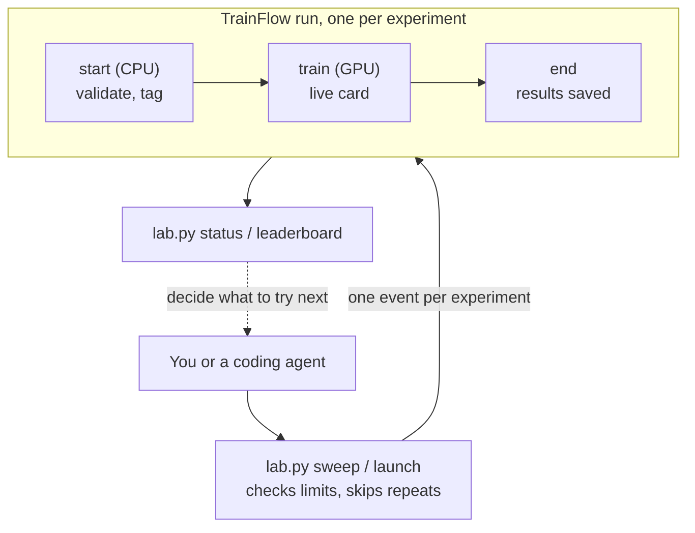

# ob_train

Train a small GPT-style language model on Tiny Shakespeare, run many experiments on it in parallel on the Outerbounds platform, and compare them. Each experiment is its own run on its own GPU with a live loss curve, a crash in one never affects the others, and a coding agent can run the search for you.

The model is deliberately small (826k parameters, about a minute per run) so that the workflow, rather than the training, is what you look at.

## Quickstart

You need Python 3.11+ with `metaflow`, `outerbounds` and `ob-project-utils` installed, a git checkout on `main`, and to be logged in to the platform. Runs on the platform install their own torch, and you only need it locally to train with `nanogpt.py`.

```bash
python src/lab.py setup                      # download the training text (once)
obproject-deploy                             # register the project, deploy TrainFlow and the compare app (see Deploying)
python src/lab.py sweep oct07                # launch the five preset experiments, printing a link per run
python src/lab.py status --sweep oct07       # running, failed, diverged or done
python src/lab.py leaderboard --sweep oct07  # best validation loss first
```

In the platform UI, open any TrainFlow run and switch to the **Cards** tab to watch its loss and learning-rate curves update while it trains. To see a whole sweep's curves overlaid, use the compare app below.

## Comparing a sweep

`deployments/compare/app.py` is a Panel app that lists a sweep's runs with their status, loss, flags and errors, and overlays the validation loss, train loss and learning rate of the runs you tick. It refreshes every 30 seconds, so finished runs and new sweeps appear while you watch, and it reads everything through `lab.py`, so its numbers match `status` and `leaderboard`.

```bash
PYTHONPATH=src python -m panel serve deployments/compare/app.py --dev --show   # locally, from the repo root
```

## How it works



`lab.py` never calls the training code directly. It publishes an event for each experiment and the platform starts a TrainFlow run from it, which means runs keep going after your laptop closes and nothing that launches experiments needs access to the training code. Every run checks its settings on a CPU machine before it asks for a GPU, and is tagged with its label, a hash of its full config and the git commit of its code, which is how repeats are skipped and how results are grouped.

## Adding an experiment

An experiment is the baseline in `src/config.py` with some settings changed. To keep one around, add a line to `PRESETS`:

```python
"exp-f-lr-dropout": {"lr": 1e-3, "dropout": 0.2},
```

For a one-off, or a range of values, skip the file:

```bash
python src/lab.py launch '{"lr": 2e-3, "dropout": 0.2}' --sweep oct07
python src/lab.py sweep lr-scan --grid '{"lr": [1e-4, 3e-4, 1e-3, 3e-3]}'
```

Every launch is checked against the limits in `src/config.py` before anything starts, and a typo like `{"n_layer": 600}` fails immediately on your machine. Experiments that already succeeded or are still running on the same code are skipped, which means rerunning a sweep starts only what's new or what failed. Every run is tagged with the git commit it ran, and the same config on a new commit counts as a new experiment, so after a code change and a redeploy everything runs again. Changing the baseline itself gives every experiment a new config hash, with the same effect.

A sweep is only a label. It groups experiments for `status`, `leaderboard` and the compare app, and you can add to an existing sweep at any time.

## When a run fails

A failure stays inside its own run. `python src/lab.py status` shows the error line, and the run's page shows the full traceback next to the code that produced it. After fixing the code, redeploy, then rerun the sweep (failed configs aren't skipped) or resume the run so only the steps that didn't finish run again:

```bash
PYTHONPATH=src python flows/train/flow.py --environment=fast-bakery resume --with kubernetes
```

The `exp-d-width` preset fails on purpose: `flows/train/nanogpt.py` builds its output layer with a hardcoded width of 128, so the 256-wide model crashes on its first forward pass. Changing it to `nn.Linear(cfg.n_embd, vocab_size, bias=False)` fixes it.

## Letting a coding agent run the search

A coding agent such as Kilo or Claude Code can drive the whole loop: propose a few experiments with a hypothesis each, launch them with `lab.py`, read the results with `status --json`, rerun promising configs with `lab.py replicate`, and decide what to try next. `AGENTS.md` gives it the workflow, the budget and stopping rules, and when to stop and ask you, for example when the same error crashes different configs, which points at a code bug rather than a bad config.

Two guardrails hold whatever the agent does, because they are in code. `lab.py launch` refuses to change the seed, the train/validation split or how loss is measured, since a config that improves the score by moving the yardstick isn't a better config, and seeds change only through `lab.py replicate`, which uses a fixed set. Every launch also goes through `config.resolve()` and its limits. The GPU budget and the stopping rules are instructions in `AGENTS.md`, so watch the first few rounds.

An agent that edits code works on an `exp/<idea>` branch and runs its worktree's code directly, so several agents can try different model changes side by side:

```bash
PYTHONPATH=src python flows/train/flow.py --environment=fast-bakery run --with kubernetes --sweep <name>
```

## Files

```
obproject.toml              project name, platform, and the branch launches go to
src/config.py               baseline, presets, limits and shared constants: the file you edit
src/lab.py                  launch, sweep, replicate, status, leaderboard (CLI and Python)
flows/train/flow.py         TrainFlow: one experiment as one platform run, on a GPU, with a live card
flows/train/nanogpt.py      the model and its training loop
deployments/compare/        the compare app and its deployment config
requirements.txt            what the deployed app needs; flow steps install their own packages
AGENTS.md                   the workflow and rules for coding agents
```

This is the layout `obproject-deploy` expects: it deploys every `flows/*/flow.py` and `deployments/*/config.yaml`, and puts `src/` on the import path. The training text is cached in `.cache/` on first use and not committed; it can't live in `data/`, which `obproject-deploy` reserves for registered data assets.

## `lab.py` reference

| command | does |
|---|---|
| `setup` | Downloads the training text to `.cache/tiny_shakespeare.txt`. |
| `sweep NAME [--presets a,b] [--grid JSON] [--branch B]` | Launches presets and/or every combination in a grid, tagged `sweep:NAME`. With neither option, launches all presets. |
| `launch [JSON] [--sweep S] [--label L] [--branch B]` | Launches one config, given as overrides on the baseline. Seed and measurement fields can't be set. |
| `replicate HASH [--seeds 43,44] [--branch B]` | Reruns a succeeded config with other seeds, into the same sweep. |
| `status [--sweep S] [--limit N] [--json]` | Recent runs with their status, loss, GPU time, error and link. |
| `leaderboard [--sweep S] [--limit N] [--by-family] [--json]` | Healthy finished runs, best first. `--by-family` groups seed replicates and ranks them by mean. |

The same functions (`launch`, `sweep`, `replicate`, `observe`, `leaderboard`, `sweeps`, `curves`) can be imported from Python.

## Deploying

`obproject-deploy`, run from the repo root on `main`, registers the project with the platform, deploys TrainFlow to the project's main branch and deploys the compare app. Launches go to the branch named by `DEFAULT_BRANCH` in `src/config.py`, which has to match `[dev-assets]` in `obproject.toml`; from another git branch, `obproject-deploy` deploys to that branch instead, and launches need `--branch`.

Every deployment needs the `team:fde` and `owner:` tags, since deployments without an owner tag are deleted weekly. The app's are in its `config.yaml`. `obproject-deploy` only adds its own commit tags to flows, so after deploying, redeploy TrainFlow once with the owner tags, using the project spec it wrote:

```bash
cd flows/train && PYTHONPATH=../..:../../src python flow.py --environment=fast-bakery --production \
    --config project_spec ../../project_spec.json --config project_config ../../obproject.toml \
    argo-workflows create --tag team:fde --tag owner:ahuang@anaconda.com
```

## Guardrails

Every launch, whether from the CLI, an agent or a manual `flow.py run`, passes through `config.resolve()`, and the limits in `src/config.py` (model size, iterations, batch and context size, learning rate) therefore hold everywhere. That also makes `src/config.py` the file to protect: changes to `LIMITS` or `MEASUREMENT_FIELDS` should go through human review.

The train step is pinned to one GPU pool (`GPU_POOL` in `flows/train/flow.py`). Without the pin, extra GPU tasks on a shared queue can land on pools that never schedule them. With three GPUs in that pool, runs beyond the third queue until one finishes.
